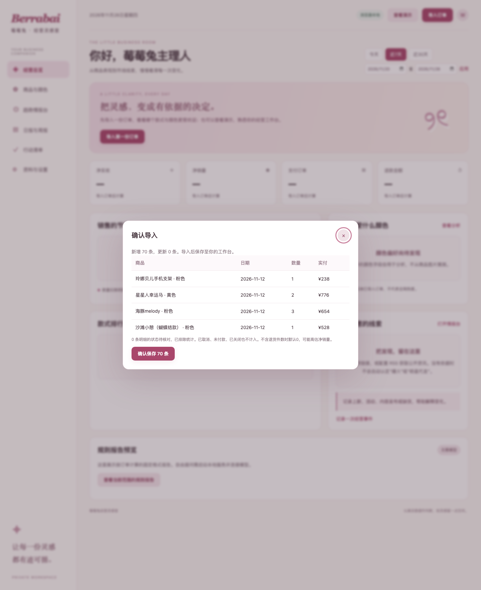
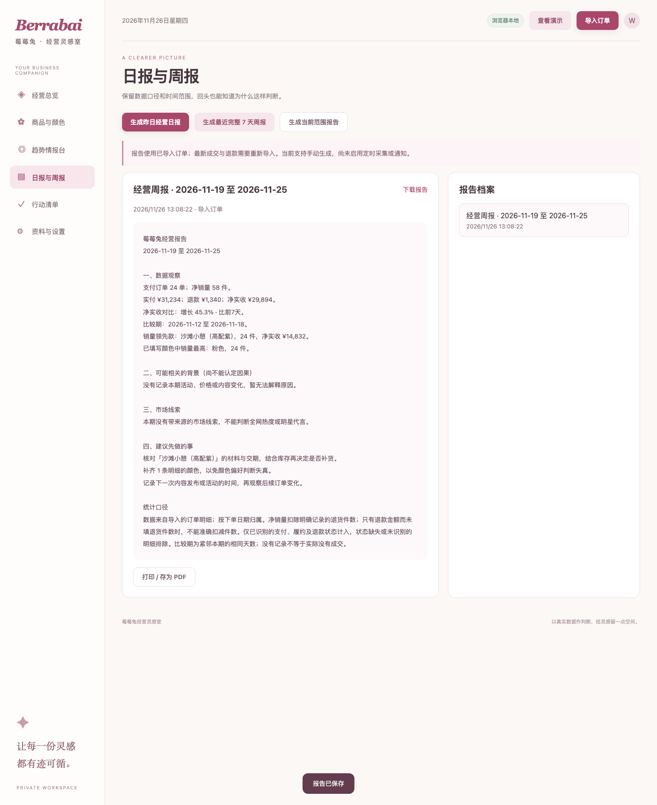

# Berrabai 经营工作台：产品案例

## 1. Business Context｜业务与使用者

Berrabai 莓莓兔经营贴钻娃娃、手机配件、永生花等手工定制商品。主理人的工作涉及款式与配色选择、定制需求沟通、供应商协调、制作交付和日常经营安排。商品目录有多个品类，同一款也可能存在不同颜色或规格。

工作台面向品牌经营者本人。小程序继续承担交易，工作台负责整理订单表现和经营记录。现阶段通过后台导出的订单文件更新分析数据，尚未直接读取小程序云数据库。

## 2. Problem Definition｜要回答的问题

本项目从三个经营问题出发：某段时间哪些款式和颜色卖得更多；退款后实际留下多少收入与销量；同期上新、活动或内容发布，是否值得与订单变化一起观察。

例如，看到紫色款销量上升时，需要同时查看成交件数、退款、同期发布记录，再决定是否优先准备材料。单看商品咨询或一条市场消息，不足以作补货判断。这里是设计场景，并非已经验证的经营结论。

前期讨论过消费者咨询和反馈收集，后来将范围收敛到主理人自己的分析工具。当前没有记录足够的真实整理耗时、错误率或用户访谈，不能据此断言原后台效率低，或声称工作台已降低了多少人工成本。需要用实际订单整理过程验证这一判断。

## 3. Product Decisions｜优先级与取舍

| 决策 | 原因与代价 |
| --- | --- |
| 先做订单、退款、款式、颜色 | 对应明确经营问题，能通过订单明细核对结果；字段不完整时会影响结论 |
| 同时展示净实收与净销量 | 金额退款和退货件数并不等价，分别回答收入和商品需求问题；尚无完整成本，不能计算利润 |
| 先提供文件导入 | 可以先验证字段映射、去重、退款和统计口径；每次更新仍需后台导出，不能称为实时同步 |
| 保留经营事件和来源链接 | 给变化补充背景和核实依据；不把时间上的相关性写成因果关系 |
| 计算交给程序，模型用于解释 | 指标可重复核对；模型的建议仍需主理人判断，规则报告与自由问答分开呈现 |
| 暂缓库存联动、全网热度、自动同步与定时推送 | 当前缺少相应数据或接入链路，先完成一次可核对的分析流程 |

状态统计使用明确列表，缺失和未知状态排除并提示。退款按原订单日期归属，因此净实收不是按收退款发生日统计的现金流。没有历史数据时不展示虚构增长率。

## 4. MVP Demonstration｜一次完整操作

无需安装服务即可打开 `dist/index.html`，点击「查看演示」浏览内置工作台。文件演示中展示规则报告；模型问答需另行启动服务。

核对导入流程时，使用空工作台，按以下顺序操作：

1. 选择 `examples/sample-orders.csv`，核对订单号、明细编号、日期、商品、颜色、金额、数量及状态映射。
2. 在预览中确认新增与更新数量，核对待核对状态提示，再保存。
3. 设置日期为 **2026-11-19 至 2026-11-25**。核对支付订单 **24 单**、净销量 **58 件**、实付 **¥31,234**、退款 **¥1,340**、净实收 **¥29,894**。
4. 查看款式和颜色排名，再记录同期活动或内容背景。缺少背景时保留问题，不直接解释增长原因。
5. 生成当前范围报告，核对比较期 **2026-11-12 至 2026-11-18**，其净实收为 **¥20,570**；保存或下载报告。
6. 同一文件再次导入，原明细更新而不重复累加。修改退款后重新导入，再观察净实收与净销量变化。

这些数值是仓库验收文件的核对结果，不作为工作台上线后的经营提升证据。

## 5. Validation & Iteration｜验证与下一步

目前验证覆盖整数金额计算、退款件数、多明细订单、重复更新标识、CSV 格式、状态缺失与未知状态排除、日期范围、日报周报比较期、存储冲突、管理员权限和资讯获取边界。浏览器检查还覆盖文件演示不出现自由问答框、导入预览以及从近 30 天页面生成周报时仍按前 7 天比较。

本次审查修正了两个已有问题：未知状态原先可能进入成交统计；报告比较期文字原先依赖页面筛选范围。两项均增加回归测试。README 原先已包含总览截图，本次补充导入与报告截图，并将无需配置的演示步骤放到前部。

软件测试通过只说明对应规则能执行。模型建议质量、持续使用意愿、整理耗时变化、自动同步稳定性及实际经营收益仍待验证。下一步先在真实经营周期中记录数据核对耗时、状态待核对数量和建议是否被采用，再决定优先做接口同步还是改进字段映射。

若实施自动同步，需要在微信云开发或自建后台的实际环境中完成授权、订单表映射、退款更新、重试和同步时间记录；完成端到端验证后才计为已接入。
