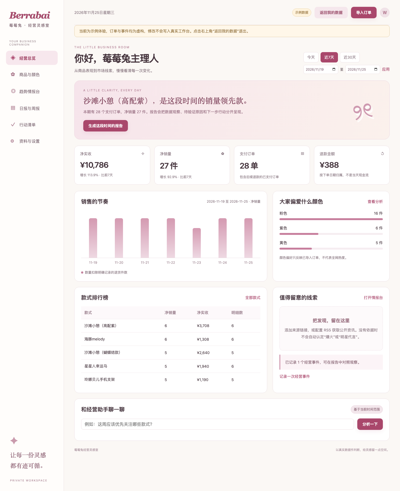
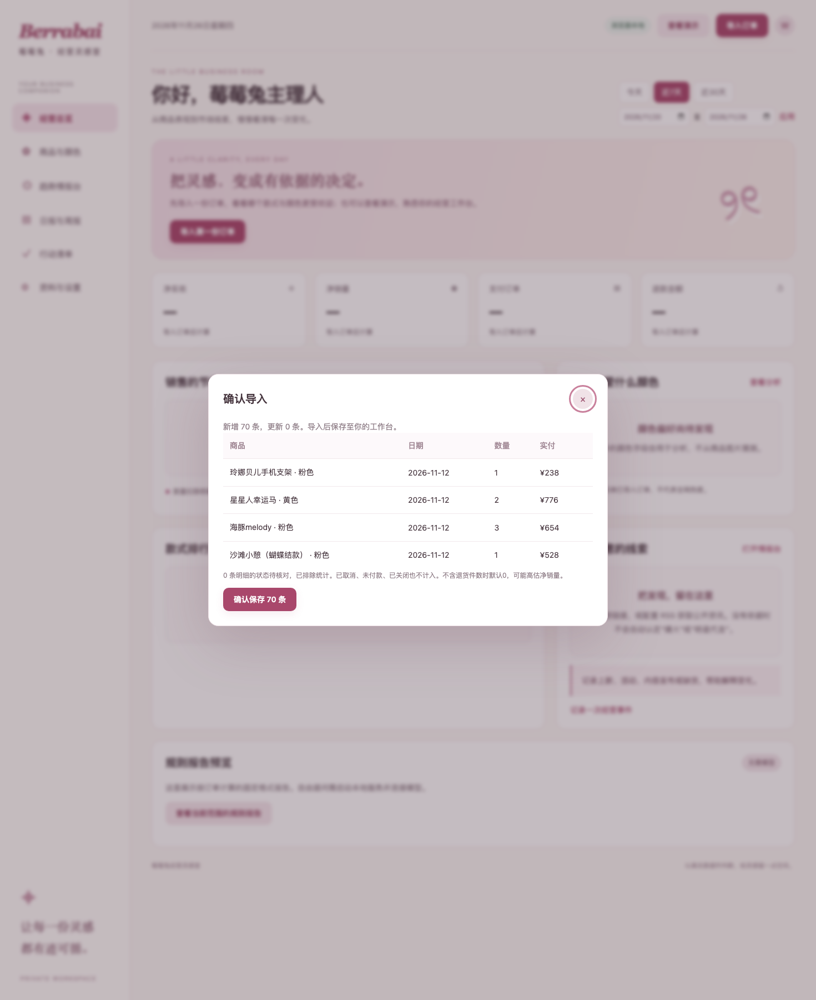

# 商家经营工作台

Berrabai 手工定制业务的内部工具，用于查看订单、款式和颜色表现，记录经营活动，并整理相关市场资讯。

商品包括贴钻娃娃、手机配件和永生花等品类。工作台将订单统计与上新、活动、内容发布等记录放在同一个页面，便于按时间查看商品表现和业务变化。



## 无需配置即可查看演示

下载仓库后，用桌面浏览器直接打开 `dist/index.html`，点击右上角「查看演示」。无需启动 Python、配置密钥或下载模型，即可查看统计、规则报告和行动清单。

文件演示只展示规则报告；AI 自由问答需要启动服务并连接模型。

**[产品案例：业务背景、取舍与验证](PRODUCT_CASE_STUDY.md)**

## 小程序数据如何进入工作台

当前通过小程序后台导出的 CSV / TSV 订单文件更新数据，支持字段映射与相同明细覆盖更新。后台重新导出后，再次导入即可更新成交和退款信息。

当前未实现小程序 API 或云数据库自动同步；接口授权、状态映射和增量更新属于后续接入工作。SQLite 保存工作台的分析数据，不替代小程序的交易后台。

## 主要功能

- **经营总览**：查看实付、退款、净实收、支付订单和净销量，支持日期筛选与上期对比。
- **商品与颜色**：按款式或颜色查看销量分布，搜索现有商品目录。
- **订单导入**：支持 CSV / TSV，包含字段匹配、导入预览、重复明细更新和退款校验。
- **趋势情报**：保存来源链接、发布日期和核实记录，支持手动获取 RSS / Atom 资讯。
- **日报与周报**：按指定日期生成报告，支持保存、下载文本和打印。
- **行动清单**：记录待办、截止日期，以及上新、缺货、价格调整等经营事件。

经营问答支持连接 Ollama 本地模型或兼容接口的云端模型。统计和普通报告通过程序计算，未连接模型时仍可使用。

## 从导入到报告

**1. 核对字段并预览导入**



**2. 选择日期，生成并保存周报**


## 本地运行

运行环境：Python 3.9+、现代浏览器。Python 服务无额外依赖。

```sh
cp .env.example .env
```

在 `.env` 中设置 `ADMIN_PASSWORD` 后启动：

```sh
set -a
source .env
set +a
python3 server.py
```

访问 [http://127.0.0.1:8765](http://127.0.0.1:8765)。模型配置、数据导入和备份方法见 [使用说明](docs/USAGE.md)。

## 业务数据

- 商品目录包含 164 款商品、21 个品类，为 2026-11-23 的小程序列表快照；金额是当时展示的起价。
- [订单文件](examples/sample-orders.csv)包含 70 条订单明细，用于订单导入和统计核对。
- 订单状态采用明确的成交状态列表；空白或未识别状态标为待核对并排除统计，导入预览和总览会提示。
- 统计以订单明细为单位：净实收＝实付－退款；净销量＝购买数量－退货件数。
- 工作台数据保存在本机 SQLite，支持 JSON 备份恢复；数据库、导出备份和密钥保留在本地。

## 技术结构

前端采用原生 HTML、CSS 和 JavaScript；后端使用 Python 标准库和 SQLite。

```text
dist/                   前端页面、样式与交互
server.py               登录、业务接口与模型调用
business.py             数据校验、存储与资讯获取
catalog_snapshot.tsv    商品目录快照
examples/               示例订单
tests/                  统计与接口测试
docs/                   使用说明、运行环境与截图
```

## 当前状态

本地版本已实现订单分析、经营记录、报告和模型接入。代码与文档已托管至 GitHub，自动检查覆盖 Python 3.9、Python 3.13 和 JavaScript。已提供 Cloudflare Pages 静态演示构建：`python3 scripts/build-public-demo.py`，输出目录为 `public-demo`。公开网址需在 Cloudflare 完成首次发布后生成，配置见 [部署说明](docs/DEPLOYMENT.md)。
