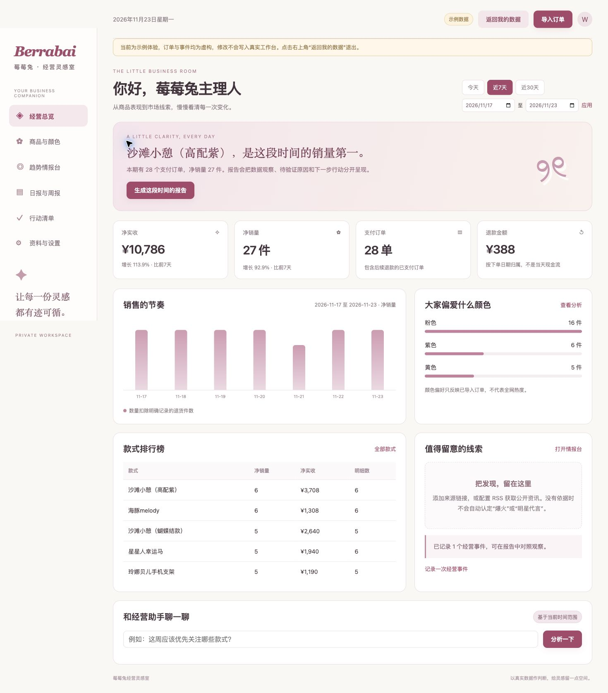

# Berrabai 莓莓兔 · 经营灵感室

面向手工定制品牌经营者的私人分析工作台：将订单、款式与颜色表现、经营事件和市场线索放在一起，让日常经营判断有数据可查。

原生 HTML / CSS / JavaScript · Python 标准库 · SQLite · 可选 Ollama 本地 AI



> 截图与测试订单为演示用途，不代表真实销售业绩。当前以本机使用为主，代码上传 GitHub 后仍需单独启动服务。

## 项目背景

定制品牌的订单表能回答“卖了多少”，但款式、颜色、内容发布和市场线索往往分散在不同地方。工作台将它们按时间关联：先计算可核对的数据，再由经营者或 AI 提出需要进一步验证的解释。

例如：查看某周粉色款的净销量，核对同期是否上新或发布内容，再结合带来源的趋势线索决定下一次试做与推广。时间上的相关性不自动等于因果关系。

## 功能一览

| 模块 | 当前已实现 |
| --- | --- |
| 经营总览 | 净实收、支付订单、净销量、退款、逐日趋势与紧邻上期比较 |
| 商品与颜色 | 款式排名、颜色分布、164 款商品目录与搜索 |
| 订单导入 | UTF-8 CSV / TSV、字段映射、校验、预览、重复明细更新 |
| 经营事件 | 记录上新、活动、内容发布、缺货、价格调整及日期 |
| 趋势情报 | 记录来源链接与核实依据，手动获取公开 RSS / Atom |
| 日报与周报 | 手动生成昨日报告、最近完整 7 天周报或自定义报告；保存、下载文本与打印 PDF |
| 经营助手 | 结合订单汇总、经营事件和情报自由提问；可选本地或兼容接口的云端模型 |
| 行动与数据 | 待办、截止日期、管理员登录、SQLite 持久化、JSON 备份恢复、并发版本检查 |

**AI 负责整理背景、解释观察和提出待验证建议。**金额和销量由代码计算；普通报告使用规则模板，不依赖模型。项目没有训练专属模型，也没有实时全网热度、自动明星代言识别、定时推送或自动经营决策。模型连接需在自己的运行环境验证。

## 快速开始

需要 Python 3.9+ 和现代浏览器。运行服务无需额外 Python 包；Node.js 仅用于开发检查。

下载或克隆仓库，进入项目根目录：

```sh
cp .env.example .env
```

编辑 `.env`，将 `ADMIN_PASSWORD` 改为自己的密码，再在 macOS / Linux 终端执行：

```sh
set -a
source .env
set +a
python3 server.py
```

打开 [本地工作台](http://127.0.0.1:8765)，使用刚设置的密码登录。服务不会自动加载 `.env`，新开终端需先加载。Python 代码或环境变量更新后需重启服务；刷新网页不会重启后端。

只体验界面时，可直接用浏览器打开 `dist/index.html`，点击「体验示例」。示例修改不会写入真实工作台。文件模式中自己的数据保存在当前浏览器，清除存储可能丢失数据；本地服务模式保存在 SQLite。两种模式都建议导出备份。

### 配置本地 AI

从 [Ollama 官网](https://ollama.com/) 安装并运行 Ollama，在另一个终端下载模型：

```sh
ollama pull qwen3:4b
```

服务未运行时可执行 `ollama serve`，已运行时无需重复启动。工作台连接本机 `127.0.0.1:11434`，使用 `LOCAL_MODEL` 指定的模型，无需云端密钥。模型文件需自行下载。没有模型时，统计、普通报告和行动清单仍可使用。

### 可选云端 AI

在本机 `.env` 中设置后，重新加载并重启服务：

```sh
AI_PROVIDER=remote
AI_BASE_URL=https://your-provider.example/v1
AI_MODEL=your-provider-model-id
AI_API_KEY=your-key
```

地址、模型名与密钥为占位示例，需替换为所选平台实际配置；接口需兼容 `POST /chat/completions`。远程分析会向所选平台发送本次订单汇总、相关事件和情报片段。密钥只放服务端环境变量，禁止写入前端或提交到仓库。

| 环境变量 | 说明 |
| --- | --- |
| `ADMIN_PASSWORD` | 必填；未设置时不能登录 |
| `PORT` | 默认 `8765`；服务仅监听本机 |
| `WORKBENCH_DB` | 可选数据库路径，默认项目目录的 `berrabai.sqlite3`；父目录需存在 |
| `AI_PROVIDER` | 推荐显式设置 `local` 或 `remote`；未设置时有密钥则远程，否则本地 |
| `LOCAL_MODEL` | 默认 `qwen3:4b` |
| `AI_BASE_URL` / `AI_MODEL` | 云端兼容接口地址与模型标识 |
| `AI_API_KEY` | 云端密钥，兼容读取 `OPENAI_API_KEY`；本地模式无需密钥 |

## 用示例订单测试

仓库包含 [70 条虚构订单明细](examples/sample-orders.csv)。进入「导入订单」，选择文件、核对字段并确认，将日期切换为 **2026-11-19 至 2026-11-25**。

| 指标 | 预期结果 |
| --- | ---: |
| 支付订单 | 24 单 |
| 净销量 | 58 件 |
| 实付金额 | ¥31,234.00 |
| 退款金额 | ¥1,340.00 |
| 净实收 | ¥29,894.00 |
| 紧邻上期净实收（11 月 12–18 日） | ¥20,570.00 |

包含多明细、部分退款、全额退款、未付款、已取消、已关闭与未填颜色等情况。日期固定，不随当天移动。请在空工作台或独立数据库中测试，避免混入真实订单；再次导入相同明细会更新记录。

## 统计口径

- 一行代表一条商品明细。必需字段：订单号、下单日期、商品名称、数量、明细实付金额；日期为 `YYYY-MM-DD`。
- 建议提供明细编号；同“订单号＋明细编号”重复导入会更新。无编号时用订单号、商品与颜色组合识别，同文件重复明细拒绝导入。
- 金额按明细填写，不要在每行重复整单总额；内部以整数分保存金额。
- 净实收＝实付－退款；净销量＝数量－明确填写的退货件数，不根据退款金额猜测件数。
- 未付款、已取消、已关闭不计入统计。支付订单按订单号去重，包含后续退款订单；退款归属原订单日期，不代表退款发生日现金流。
- 比较期为紧邻本期的相同天数；没有上期记录不等于实际零成交。缺失颜色单列展示，暂不直接支持 XLSX。

## 保存与备份

服务模式将订单、事件、情报、报告、行动和来源配置保存在本机数据库。JSON 备份可迁移到另一实例，恢复会替换业务数据；不包含模型权重、密钥或旧版咨询表。

GitHub 保存代码历史，**不承担业务数据备份**。数据库、密钥、导出文件与旧版顾客界面已加入忽略规则。完整数据库备份应先停止服务，再保存数据库及仍存在的 SQLite 配套文件。

商品目录为 2026-11-23 的 164 款、21 个品类的品牌小程序列表快照。价格为当时起价，部分可能对应寄改。除明确核对的规格外，不代表含娃最终报价、实时库存或承诺交期。

## 项目结构

```text
dist/                   网页入口、样式、分析与交互、商品目录
server.py               HTTP 服务、登录、业务接口与模型调用
business.py             存储校验、版本控制与 RSS / Atom 获取
catalog.py              商品知识初始化
catalog_snapshot.tsv    品牌商品快照
examples/               可公开的虚构订单
tests/                  分析口径、存储、资讯来源和接口测试
docs/                   部署说明与界面截图
.github/workflows/      推送与 PR 检查
.env.example            无真实凭据的配置模板
```

## 开发检查

```sh
python3 -m unittest discover -s tests -v
node --check dist/owner.js
node --check dist/catalog-data.js
node --test tests/analytics.test.cjs
```

测试使用内存或临时数据库，不接触真实业务数据，不调用真实 AI 或资讯网站；GitHub Actions 也会执行检查。

## GitHub 与网站上线

当前完整服务依赖 Python、可持久化的 SQLite 和可访问的模型环境，**不能仅靠 GitHub Pages 或 Cloudflare Pages 静态发布运行**。网页在 HTTP 模式下需要同源 `/api/*`，仅发布 `dist/` 不会得到完整工作台。

可先上传 GitHub，在本机继续使用。在线版本需选择可运行 Python 的主机，并配置 HTTPS、持久化存储、登录防护与模型连接。详见 [部署与更新说明](docs/DEPLOYMENT.md)。

## 后续迭代

根据真实反馈评估 XLSX 导入、商品与颜色别名归并、库存和制作周期关联、定时报告及线上账号运维。以上均为待实现方向。
